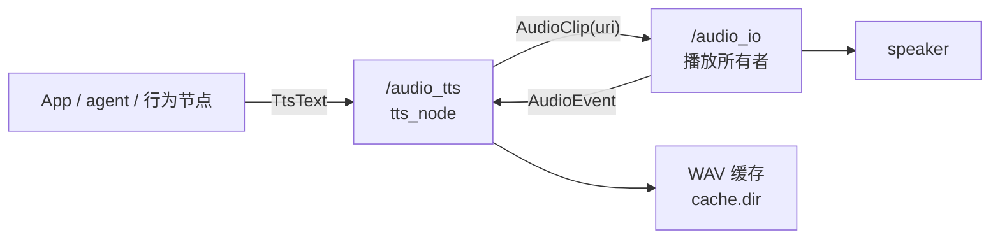

# `tts` 功能包架构：通用 TTS 节点

> 包：`tts`（库 `libtts` + 可执行 `tts_node`），节点默认全名 `/audio_tts`。
> 接口包：`tts_interface`；播放侧依赖：`audio_io` / `audio_io_interface`。
> 本文只描述本功能包，可独立用于任何 ROS 2 机器人的“文字 → 音频”需求。

---

## 1. 职责与边界

`tts` 只做一件事：把文字合成成音频，并交给播放所有者。

- **不打开声卡**：播放由 `audio_io`（或等价节点）负责；`tts` 只发布 `AudioClip`。
- **不做 ASR/唤醒词/对话理解**：输入永远是文本。
- **不持有机器人语义**：没有鸭子 tag、seed、personality；这些属于上层业务包。
- **不强制依赖云服务**：默认离线；后端由参数选择。

| 输入 | 输出 |
|---|---|
| `tts_interface/msg/TtsText`（topic/service/action） | 缓存 WAV + `audio_io_interface/msg/AudioClip` |
| — | `tts_interface/msg/TtsEvent`（合成/播放事件） |



---

## 2. 接口

端点相对于节点私有命名空间书写；默认节点全名 `/audio_tts` 时对外的绝对名称如下。

| 端点 | 类型 | 语义 |
|---|---|---|
| `/audio_tts/text` | `topic` `TtsText` | fire-and-forget：合成，`play=true` 时播放 |
| `/audio_tts/synthesize` | `service` `Synthesize` | 只合成，返回缓存音频 URI |
| `/audio_tts/say` | `action` `Say` | 长文本：逐句合成、feedback 进度、可取消 |
| `/audio_tts/event` | `topic` `TtsEvent` | 合成/缓存/播放状态、失败、取消 |

### 2.1 `TtsText`

| 字段 | 默认/空值 | 说明 |
|---|---|---|
| `text` | 空 = 拒绝 | 要合成的文本 |
| `voice_id` | 空 = 默认音色 | 数字字符串 = 多说话人 speaker id；其他字符串会被拒绝 |
| `language` | 空 = 后端默认 | BCP-47；当前只参与缓存键，模型语言由 voice 决定 |
| `rate` | ≤ 0 = 1.0 | 语速倍率，映射到后端 `length_scale = 1/rate` |
| `pitch` | ≤ 0 = 1.0 | 音高倍率；**当前后端不支持**，节点按 5 s 节流提示 |
| `volume` | 0 = `default.volume` | 线性增益，写入 `AudioClip.gain`，最大 4.0 |
| `play` | `false` | `true` 才提交播放；`false` 只合成/预热缓存 |
| `group` | 空 = `default.group`（`tts`） | 音频焦点组 |

`bool` 没有“未设置”语义：`~/text` 和 `~/say` 要出声必须显式 `play: true`；
`~/synthesize` 忽略 `play`，始终只合成。

### 2.2 `Synthesize`

请求：`TtsText request`；响应：

```text
bool success
string audio_uri   # file:///abs/path.wav
float32 duration   # 秒
string error       # 失败原因
```

### 2.3 `Say`

```text
# goal
TtsText text
# result
string request_id
# feedback
float32 progress          # 0..1，按已合成句数
string current_sentence
```

`Say` 在节点内按句切分（`max_sentence_chars`），逐句合成并提交播放；goal 之间由
单工作线程串行，句子之间由 `audio_io` 的 `QUEUE` 策略串行。

### 2.4 `TtsEvent`

| 常量 | 值 | 触发 |
|---|---|---|
| `SYNTHESIZE_STARTED` | 0 | 缓存未命中，开始调用后端 |
| `SYNTHESIZED` | 1 | 合成完成并写入缓存 |
| `CACHE_HIT` | 2 | 命中缓存，未调用后端 |
| `PLAY_STARTED` | 3 | `audio_io` 报告 `EVENT_STARTED` |
| `PLAY_FINISHED` | 4 | `audio_io` 报告 `EVENT_FINISHED` |
| `FAILED` | 5 | 合成或播放失败 |
| `CANCELED` | 6 | action 取消，或被更高优先级请求抢占 |

字段：`header`、`request_id`、`event`、`audio_uri`、`duration`、`error`。
播放类事件不是“提交成功”的乐观通知：节点订阅 `<audio_io.node>/event`，按
`request_id` 关联后才发布 `PLAY_*`。

### 2.5 播放策略

| 来源 | priority | policy | group |
|---|---|---|---|
| `~/text` | `PRIORITY_SPEECH` | `POLICY_REPLACE_SAME_GROUP` | `TtsText.group` 或 `tts` |
| `~/say` 每句 | `PRIORITY_SPEECH` | `POLICY_QUEUE` | 同上 |

`~/text` 的语义是“新信息覆盖旧信息”，不会压掉 `ALERT`；`~/say` 按顺序播完。
需要“打断旧播报”的客户端用 `~/text`；需要“连续播报”的用 `~/say`。

---

## 3. 节点结构

```
tts_node (可执行)
  └─ common_cpp RclcppLogHandler 初始化（进程级，只在这里做）
  └─ MultiThreadedExecutor(4)
       └─ tts::TtsNode(node)        ← 组合式，不继承 rclcpp::Node
            ├─ 回调组：text / io event / service / action（各自 mutually exclusive）
            ├─ say 工作线程（std::jthread + 队列）
            ├─ backend_mutex_：同一时刻只跑一个后端合成
            ├─ TtsBackend（piper 或 paroli）
            └─ TtsCache
```

设计要点：

- **组合而非继承**：`TtsNode(rclcpp::Node::SharedPtr)`，其他包可以把本节点并入自己的
  执行器，共享参数与回调组。
- **两个 target**：`libtts` 承载节点、后端、缓存与音频工具；`tts_node` 只做 ROS 组合与
  日志初始化。库不链接 `common_cpp_ros_logging`，避免进程级副作用。
- **回调隔离 ≠ 并行合成**：`~/text`、`~/synthesize`、`~/say`、`~/event`/`audio_io` 事件分属
  不同 callback group，隔离的是“接收、取消、事件回调不会被某个长回调卡住”；
  **后端推理由 `backend_mutex_` 串行**，同一时刻最多一个 piper/paroli 合成，不会并发占用
  CPU/NPU 或重复加载模型。缓存命中在锁外完成，可以在别的请求合成期间直接返回。
- **合成串行**：后端可能有子进程/HTTP 状态，`backend_mutex_` 保证单飞；缓存二次检查
  避免并发重复合成。
- **取消**：action cancel 置位 `std::atomic_bool`；piper 会杀掉子进程组，paroli 会中止
  curl 传输。取消后清理临时文件并发布 `CANCELED`。

### 3.1 并发与阻塞

| 情况 | 实际行为 |
|---|---|
| `~/text` 冷合成 + `~/synthesize` 冷合成 | service 在 `backend_mutex_` 上等待；不会并行推理 |
| 后端忙时另一个请求命中缓存 | 直接返回缓存 URI / 提交播放，不等待后端 |
| `~/say` 正在逐句合成 + 新 `~/text` | `say` 在句与句之间释放锁，text 可在句子间隔插入；正在合成的那一句不可抢占，除非取消 goal |
| 长合成期间 `audio_io` 事件 | io 回调在独立 group/线程，正常映射 `PLAY_*` |
| 长合成期间 action cancel | cancel 回调立即置位取消标志，后端在下一次轮询中止 |
| 多个 `~/text` 连续到达 | 订阅的 group 互斥：同一时刻最多一个 text 回调在合成/等锁，其余消息在执行器队列里排队，不额外占线程 |

执行器是 4 线程：`~/text` 与 `~/synthesize` 各最多占 1 个等待线程，`~/say` 合成跑在
独立工作线程，因此事件订阅通常仍有线程可用。压力不在“并行推理”，而在**排队延迟**：
后到的电量/状态短句可能排在一段长播报之后。板端建议：长内容统一走 `~/say`，状态类短句
走 `~/text`，客户端避免同时发起多条互不相关的合成；需要“状态优先打断播报”时，应在应用
层先取消 `say` goal 再发 `~/text`。

---

## 4. 后端

`TtsBackend` 是包内抽象接口（`include/tts/tts_backend.hpp`）：

```cpp
virtual std::string_view name() const noexcept = 0;
virtual std::string fingerprint() const = 0;              // 参与缓存键
virtual std::expected<void, std::string> initialize() = 0;
virtual std::expected<SynthesisResult, BackendError>
synthesize(const SynthesisRequest& request) = 0;
```

后端只写 WAV，不发布 ROS 消息、不碰声卡。当前不使用 pluginlib：只有两个内置后端，
编译期工厂足够；新增后端 = 实现接口 + 在 `TtsNode::create_backend()` 加一个分支。

### 4.1 `piper`

- 调用 `piper` CLI 子进程；`argv`：`--model`、`--output_file`，可选 `--config`、
  `--speaker`、`--length_scale`、`--espeak_data`。
- 文本经 `memfd_create` 匿名文件送入 stdin；stderr 捕获，失败时截取尾部写入错误。
- 超时 `backend.timeout_ms`；取消/超时会杀掉整个进程组。
- `rate != 1` 时传 `--length_scale 1/rate`；`pitch` 不支持。
- 指纹包含可执行文件、模型路径、模型 mtime、config、speaker。

### 4.2 `paroli`

- 请求 `POST <paroli.url>/api/v1/synthesise`：
  `{"text": "...", "audio_format": "pcm"}`，可选 `speaker_id`、`length_scale`。
- 响应是模型原生采样率的裸 16-bit little-endian mono PCM；节点按
  `paroli.sample_rate` 写 WAV。该参数必须与模型一致，否则播放速度错误。
- 使用 libcurl 同步请求；`CURLOPT_TIMEOUT_MS` 控制超时，progress 回调响应取消。
- HTTP 非 200、空 PCM、奇数字节都会作为失败返回。
- 指纹包含 URL、采样率、speaker。

`paroli` 的 REST 接口返回完整音频，不是流式；实时流需要后续接入 WebSocket
`/api/v1/stream`。

---

## 5. 缓存

- 键：`SHA-256(backend fingerprint + text + voice_id + language + rate + pitch)`；
  后端指纹包含模型路径/mtime 或 paroli URL + 采样率，换模型不会命中旧音频。
- 目录：`cache.dir`，默认 `~/.cache/robot_audio/tts/`。
- 写入：先写 `<key>.tmp-<n>`，成功后原子 `rename` 为 `<key>.wav`。
- 命中：读取 WAV 头校验；损坏文件会被删除并按未命中处理；命中刷新 mtime。
- LRU：合成前按 `cache.max_bytes` 统计，按 mtime 从旧到新删除；0 表示不限制。
- 失败/取消：临时文件删除，不污染缓存。

---

## 6. 参数

| 参数 | 默认 | 说明 |
|---|---|---|
| `backend` | `piper` | `piper` / `paroli` |
| `piper.executable` | `piper` | 可执行文件或 PATH 名字；支持 `~` |
| `piper.model` | 空（piper 必填） | `.onnx` voice；支持 `~` |
| `piper.config` | 空 | 空 = `<model>.json` |
| `piper.espeak_data` | 空 | espeak-ng-data 目录 |
| `piper.speaker` | `-1` | 默认 speaker id |
| `paroli.url` | `http://127.0.0.1:8848` | paroli-server 根地址 |
| `paroli.sample_rate` | `22050` | 必须等于模型原生采样率 |
| `paroli.speaker_id` | `-1` | 默认 speaker id |
| `backend.timeout_ms` | `30000` | 单次合成超时 |
| `audio_io.node` | `/audio_io` | 播放节点全名；决定 `<fqn>/play` 与 `<fqn>/event` |
| `frame_id` | `audio` | `AudioClip`/`TtsEvent` 的 frame_id |
| `default.group` | `tts` | 默认音频焦点组 |
| `default.volume` | `1.0` | `volume=0` 时的增益 |
| `max_sentence_chars` | `120` | `~/say` 单句最大码点数 |
| `cache.dir` | `~/.cache/robot_audio/tts` | 缓存目录 |
| `cache.max_bytes` | `268435456` | LRU 上限；0 = 不限制 |
| `log.log_level` | `info` | common_cpp |
| `log.log_path` | `./log` | common_cpp |
| `log.async` | `false` | common_cpp |

参数文件示例见 `config/tts.yaml`；launch 支持 `config:=<path>` 与 `namespace:=robot1`。

---

## 7. 延迟预算

2026-11 在 x86_64 开发机实测（piper `zh_CN-huayan-medium` CPU，`audio_io backend=null`，
队列空闲）：

| 场景 | 延迟 |
|---|---|
| piper CLI 短句（含模型加载） | 0.22–0.29 s |
| `~/text` 冷合成 → 首个音频 | 0.30–0.33 s |
| `~/text` 缓存命中 → 首个音频 | 0.10 s |
| `~/synthesize` 冷 / 命中 | 0.26–0.29 s / ~0.001 s |
| `~/say` 接受 goal | ~0.001 s |
| `~/say` 首句出声 | 0.30 s |
| `~/say` 两句全部合成完 | 0.53–0.56 s（播放继续，无空隙） |

分解：合成 → 写 WAV（~1 ms）→ `audio_io` 解码/起播（~0.1 s）。首音频不等于整段音频
合成完：`~/say` 在上一句播放时并行合成下一句。

板端未实测；RK3566 CPU 跑 piper medium 会明显慢于上述数字，建议用常驻
`paroli-server` + RKNN。缓存命中或预渲染固定短语时，成本只剩 `audio_io` 起播。
当前没有 `AudioStream` 输出，所以“首音频”= 第一句/整段完整合成。

---

## 8. 失败模式

| 失败 | 行为 |
|---|---|
| piper 模型/可执行文件缺失 | 节点启动但后端 `unavailable`；`Synthesize` 返回错误，`~/event FAILED` |
| paroli-server 不可达/非 200 | 同上；节点保持运行，不自动切换后端 |
| piper 超时 / 取消 | 杀进程组、删临时文件；事件 `CANCELED` 或 `FAILED` |
| 缓存目录不可写 | 节点构造抛异常，`tts_node` 退出（属于配置错误） |
| 输出 WAV 非法/空 | 视为后端失败，不写缓存 |
| `audio_io` 不存在 | 合成仍可用；`AudioClip` 无人订阅，播放事件不会出现 |
| `audio_io` 抢占/播放失败 | 由 `AudioEvent` 映射为 `CANCELED` / `FAILED` |

---

## 9. 包布局

```text
tts/
  include/tts/
    tts_node.hpp  tts_backend.hpp  piper_backend.hpp  paroli_backend.hpp
    tts_cache.hpp wav_io.hpp sentence_splitter.hpp process_runner.hpp paths.hpp
  src/
    tts_node.cpp  piper_backend.cpp  paroli_backend.cpp  tts_cache.cpp
    wav_io.cpp  sentence_splitter.cpp  process_runner.cpp  paths.cpp  main.cpp
  config/tts.yaml
  launch/tts.launch.py
  tools/install_piper.sh
  test/
  docs/
```

构建依赖：`rclcpp`、`rclcpp_action`、`common_cpp`、`audio_io_interface`、`tts_interface`、
系统 `libcurl`、`libssl`（缓存键 SHA-256）。

---

## 10. 运行

### 10.1 开发机（piper）

```bash
source /opt/ros/humble/setup.bash
colcon build --base-paths src --packages-select tts
source install/setup.bash

# 下载 piper 与默认中文音色到 ~/.local/share/tts
install/tts/share/tts/tools/install_piper.sh
# 可选：install/tts/share/tts/tools/install_piper.sh en_US-lessac-medium

ros2 launch tts tts.launch.py
```

### 10.2 板端（paroli-server）

```bash
./paroli-server --encoder encoder.onnx --decoder decoder.onnx \
  -c model.json --ip 127.0.0.1 --port 8848

ros2 run tts tts_node --ros-args \
  -p backend:=paroli \
  -p paroli.url:=http://127.0.0.1:8848 \
  -p paroli.sample_rate:=22050
```

### 10.3 验证

```bash
ros2 service call /audio_tts/synthesize tts_interface/srv/Synthesize \
  "{request: {text: '你好，我是小鸭', language: zh-CN}}"

ros2 topic pub --once -w 0 /audio_tts/text tts_interface/msg/TtsText \
  "{text: '你好，我是小鸭', play: true}"

ros2 action send_goal /audio_tts/say tts_interface/action/Say \
  "{text: {text: '第一句。第二句。', play: true}}" --feedback

ros2 topic echo /audio_tts/event
```

---

## 11. 限制与后续

- 不支持 `pitch`；需要变调时应在后端外部处理。
- 不发布 `AudioStream`：所有播放是 WAV + `AudioClip`，首音频等于一次完整合成；
  后续可让后端输出 PCM 分块并走 `<audio_io>/stream`。
- 输入不是增量文本：agent 若逐 token 输出，需要按句聚合并用 `~/say`（或多 goal），
  不能把半句反复发 `~/text`，否则 `REPLACE_SAME_GROUP` 会互相打断。
- 没有 eSpeak/云后端和自动 fallback；后端由参数显式选择。
- REST paroli 不流式；WebSocket 流式接口尚未接入。
- 合成没有优先级队列/合并：后到的短状态请求只能等当前合成结束；需要“状态抢占播报”时
  由客户端取消 `say` goal。若后续加入调度器，应保留单飞推理并按优先级/最新覆盖排队。
